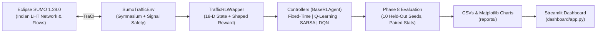
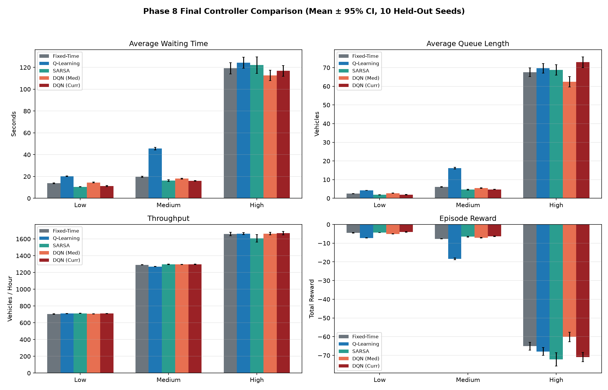
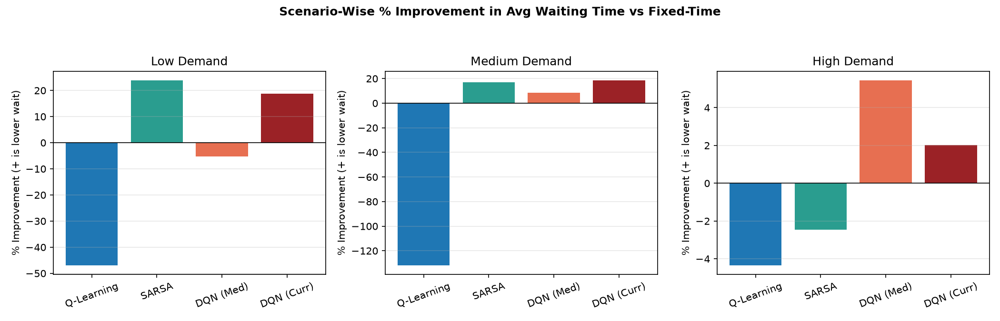

# Intelligent Traffic Signal Controller Using Reinforcement Learning

[](https://www.python.org/)
[](https://eclipse.dev/sumo/)
[](https://pytorch.org/)
[](https://gymnasium.farama.org/)
[](https://streamlit.io/)

An adaptive **Reinforcement Learning (RL)** traffic signal control system built for an **Indian Left-Hand-Traffic (LHT) four-way urban intersection** using **Eclipse SUMO**, **TraCI**, **Gymnasium**, **CPU-only PyTorch**, and **Streamlit**.

---

## Problem Statement & Objectives

Conventional **fixed-time** traffic signals cycle through predetermined green intervals regardless of real-time queue imbalances, leading to wasted green time under light traffic and severe congestion during peak hours.

This project investigates whether adaptive RL controllers can reduce vehicle waiting times and queue lengths while strictly preserving signal safety:
1. Model an **Indian LHT 4-way intersection** (`--lefthand true`) with heterogeneous Indian urban traffic.
2. Wrap SUMO + TraCI in a clean **Gymnasium** environment with hardware-independent **safety interlocks** (`min_green`, `yellow`, `all_red`, protected right turns).
3. Benchmark **Fixed-Time**, **Tabular Q-Learning**, **Tabular SARSA**, **DQN (Medium-only)**, and **DQN (Curriculum)** across **Low, Medium, and High** demand regimes using **10 held-out evaluation seeds** (`150` total frozen episodes).
4. Provide an interactive **Streamlit** dashboard for exploring simulation metrics, training curves, and statistical significance.

---

## Indian Traffic Simulation Details

| Parameter | Configuration | Rationale |
| :--- | :--- | :--- |
| **Driving Rule** | Left-hand traffic (`<lefthand value="true"/>`) | Standard Indian road rule (keep left, RHD vehicles) |
| **Geometry** | 4-way junction (`N`, `S`, `E`, `W`), 250 m arms, 2 lanes/direction (`3.5 m` width) | Aligned with IRC:86 urban arterial standards (`50 km/h` / `13.89 m/s`) |
| **Lane Assignment** | Lane `0` (left/curb): Left + Straight; Lane `1` (right/median): Protected Right | Eliminates opposing right-turn conflicts |
| **Vehicle Mix** | Motorcycles (`38%`), Cars (`30%`), Auto-rickshaws (`20%`), Buses (`6%`), Trucks (`6%`) | Reflects mixed Indian urban traffic |
| **Safety Timing** | `min_green = 10 s`, `yellow = 3 s`, `all_red = 2 s`, `right_turn_green = 5 s` | Enforced independently of RL agent actions |

---

## System Architecture



---

## Controllers Implemented

1. **Fixed-Time (`algorithms/fixed_time.py`):** Deterministic baseline alternating North–South (`25 s`) and East–West (`20 s`).
2. **Tabular Q-Learning (`algorithms/q_learning.py`):** Off-policy TD control over a compact `96`-state discretization (`4 × 4 × 2 × 3`).
3. **Tabular SARSA (`algorithms/sarsa.py`):** On-policy TD control over the same `96`-state representation.
4. **DQN Medium-Only (`algorithms/dqn.py`):** CPU-only MLP (`18 → 128 → 64 → 2`) with `ReplayBuffer`, target network, Smooth L1 loss, and gradient clipping, trained for `15` episodes on Medium demand.
5. **DQN Curriculum (`evaluation/train_dqn_curriculum.py`):** Same `18 → 128 → 64 → 2` architecture trained progressively across `Low → Medium → High → Mixed` stages (`15` episodes), tuned via controlled one-factor-at-a-time experiments (`lr = 5e-4` selected strictly on training reward).

---

## Phase 8 Evaluation Results (`10` Held-Out Seeds `1001–1010`, `1800 s`, Frozen Models)

All controllers were evaluated under identical traffic demand with `epsilon = 0.0` and zero learning updates (`150` total episodes).

### Summary: Average Waiting Time (`Mean ± Std`, `% vs Fixed-Time`)

| Controller | Low (~720 veh/hr) | Medium (~1,330 veh/hr) | High (~2,200 veh/hr) |
| :--- | ---: | ---: | ---: |
| **Fixed-Time** | `13.79 ± 0.47 s` | `19.67 ± 0.61 s` | `119.20 ± 7.17 s` |
| **Q-Learning** | `20.26 ± 0.30 s` (`-46.91%`) | `45.59 ± 1.69 s` (`-131.77%`) | `124.38 ± 7.02 s` (`-4.34%`) |
| **SARSA** | **`10.50 ± 0.22 s` (`+23.83%`)** | `16.34 ± 1.11 s` (`+16.93%`) | `122.12 ± 10.67 s` (`-2.45%`) |
| **DQN (Medium-only)** | `14.51 ± 0.60 s` (`-5.18%`) | `18.00 ± 0.67 s` (`+8.49%`) | **`112.72 ± 6.61 s` (`+5.44%`)** |
| **DQN (Curriculum)** | `11.19 ± 0.70 s` (`+18.84%`) | **`16.04 ± 0.48 s` (`+18.49%`)** | `116.80 ± 6.75 s` (`+2.02%`) |

### Key Statistical Findings (Paired $t$-test & Exact Permutation Test, $\alpha = 0.05$)
- **Low Demand:** `SARSA` (`p = 0.00195`) and `DQN Curriculum` (`p = 0.00195`) significantly reduce waiting time vs `Fixed-Time`; `DQN Curriculum` significantly improves over `DQN Medium-only` (`p = 0.00195`).
- **Medium Demand:** `DQN Curriculum` achieves the lowest waiting time (`16.04 s`, `p = 0.00195` vs `Fixed-Time` and `p = 0.00195` vs `DQN Medium-only`).
- **High Demand:** `DQN Medium-only` achieves a statistically significant reduction vs `Fixed-Time` (`p = 0.0332` permutation, `p = 0.0382` paired $t$), while `DQN Curriculum` achieves the highest vehicle throughput (`1668.2 veh/hr`) with non-significant waiting-time difference (`p = 0.375`).

---

## Visual Results & Charts





---

## Technology Stack

- **Simulation:** Eclipse SUMO `1.28.0`, TraCI `1.28.0`, sumolib `1.28.0`
- **RL & ML:** Python `3.11`, Gymnasium `1.4.0`, NumPy `2.4.6`, PyTorch `2.15.0+cpu`
- **Analytics & UI:** Pandas `3.1.1`, Matplotlib `3.11.2`, Plotly `7.2.0`, Streamlit `1.67.0`

---

## Installation & Windows Launch Instructions

1. **Install Eclipse SUMO (`1.28.0`)** and ensure `SUMO_HOME` is set (e.g., `C:\Program Files (x86)\SUMO`).
2. **Create a Python 3.11 environment and install dependencies:**
   ```powershell
   conda create --prefix E:\conda_envs\traffic_rl python=3.11 -y
   E:\conda_envs\traffic_rl\python.exe -m pip install -r requirements.txt --extra-index-url https://download.pytorch.org/whl/cpu
   ```
3. **Compile the SUMO network (one-time):**
   ```powershell
   cd simulation/network
   netconvert -c intersection.netccfg
   ```
4. **Launch the Interactive Dashboard:**
   ```powershell
   E:\conda_envs\traffic_rl\python.exe -m streamlit run dashboard/app.py
   ```

---

## Running Tests

Run the complete `41`-test unit and live SUMO integration suite:
```powershell
E:\conda_envs\traffic_rl\python.exe -m unittest discover -s tests -v
```

---

## Limitations & Future Improvements

- **Training Budget:** Tabular agents and DQN were trained for `15` episodes per run to keep CPU runtime practical; longer training schedules may improve Q-Learning state coverage and High-demand DQN convergence.
- **Single-Intersection Scope:** Evaluates an isolated 4-way intersection; multi-intersection green-wave coordination is left for future work.
- **Multiple Comparisons:** Paired $t$-tests and permutation tests across 10 seeds are reported without Bonferroni adjustment.
