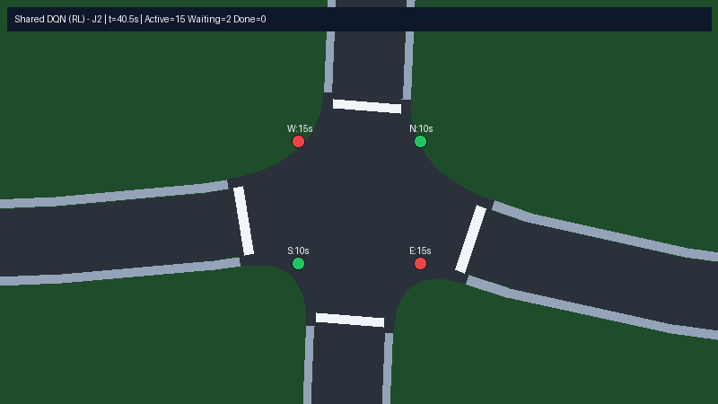
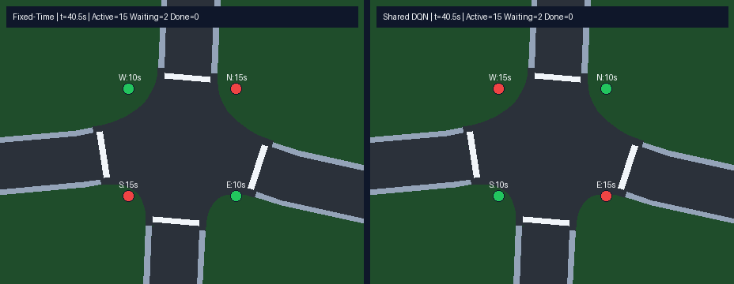
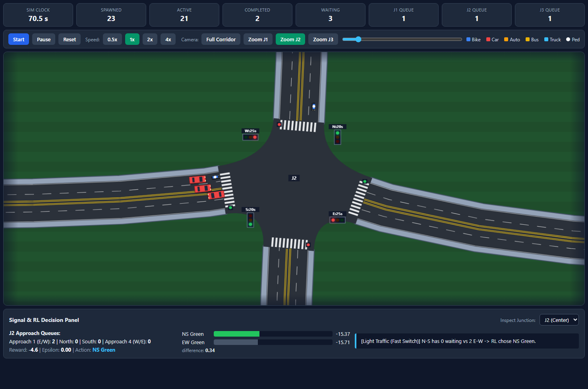
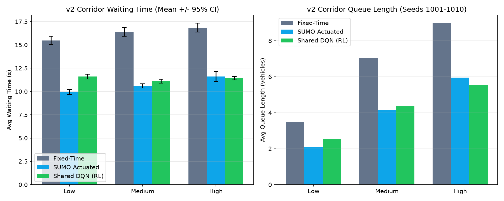
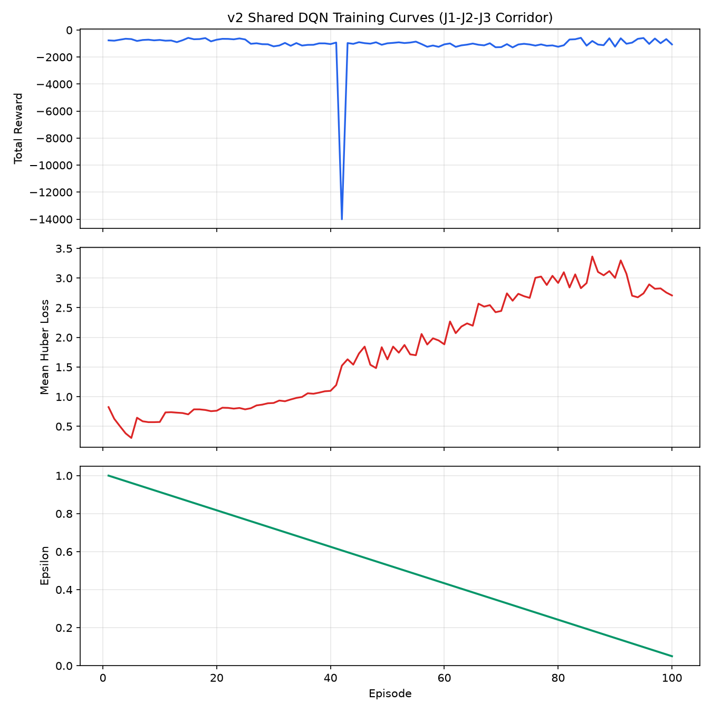

# Intelligent Traffic Signal Controller Using Reinforcement Learning

> **An end-to-end AI traffic signal control system** built with **Eclipse SUMO 1.28.0**, **TraCI**, **CPU PyTorch**, and a **6-page Streamlit + 60 FPS HTML5 Canvas dashboard** for **Indian Left-Hand Traffic (LHT)** mixed-vehicle corridors.

---

## 1. What Is This Project & Why Does It Matter?

Traditional traffic lights run on **fixed timers** (e.g., 25 s North-South, 20 s East-West), even when one road is empty and the cross road has a long queue.

This project trains a **Deep Q-Network (DQN)** agent to observe live queues and waiting times at each intersection and **adaptively switch signals** while obeying strict road-safety rules (`10 s` minimum green, `3 s` yellow, `2 s` all-red).

### Practical Use Cases
- **Smart City / ITS Prototyping:** Test RL signal policies safely in realistic SUMO microsimulation before any field deployment.
- **Indian Mixed-Traffic Modeling:** Models motorcycles (`45%`), cars (`25%`), auto-rickshaws (`10%`), buses (`10%`), trucks (`10%`), and zebra-crossing pedestrians under Left-Hand Traffic (LHT) rules.
- **Academic & Portfolio Benchmark:** Reproducible baseline comparisons (`Fixed-Time` vs `SUMO Actuated` vs `Shared DQN`) with confidence intervals and Holm-corrected statistical tests.

---

## 2. Live Auto-Playing Demo & Visual Results (`v2`)

### Live 2D Corridor Replay (Auto-Playing)


### Side-by-Side Compare: Fixed-Time vs Shared DQN (Auto-Playing)


### Full Dashboard Replay & RL Decision Panel


### Demo Video Recordings (`videos/`)
1. **Traffic Simulation — Zoomed Junction:** [`Traffic Simulation-1.mp4`](videos/Traffic%20Simulation-1.mp4) — Live vehicles, brake/headlights, pedestrians, countdowns, and RL Decision Panel.
2. **Traffic Simulation — Full Corridor:** [`Full Corridor.mp4`](videos/Full%20Corridor.mp4) — All 3 curved junctions (`J1–J2–J3`) running simultaneously.
3. **Traffic Simulation — Extended Flow:** [`Traffic Simulation-2.mp4`](videos/Traffic%20Simulation-2.mp4) — Multi-junction coordination across demand transitions.
4. **Side-by-Side Compare Mode:** [`Side-by-Side Compare Mode.mp4`](videos/Side-by-Side%20Compare%20Mode.mp4) — Synchronized Fixed-Time vs Shared DQN comparison.
5. **Analytics & Statistical Results:** [`Statistical Results & Overview - Controller Comparison & Training Analysis.mp4`](videos/Statistical%20Results%20%26%20Overview%20-%20Controller%20Comparison%20%26%20Training%20Analysis.mp4) — Overview, 95% CI charts, training curves, and Holm-corrected p-values.

### Controller Comparison (10 Held-Out Seeds, Mean ± 95% CI)


### Shared DQN Training Curves (100-Episode Curriculum)


---

## 3. How It Works (A to Z)

1. **A — Road Network (`v2/network/build_network.py`):** Compiles a **3-junction curved arterial corridor (`J1–J2–J3`)** with `215.9 m – 298.1 m` cubic Bezier road segments, `2` motorized lanes + `2.0 m` sidewalks per direction, rounded `J2` junction geometry, and zebra crossings (`--lefthand true`).
2. **B — Realistic Traffic & Pedestrians (`v2/traffic/generate_traffic.py`):** Generates Poisson-arrival traffic across 3 demand levels — **Low** (`~720 veh/hr`), **Medium** (`~1330 veh/hr`), and **High** (`~1660 veh/hr`) — with straight, left, and right turns plus `120` pedestrians/hr at zebra crossings. Training seeds (`1–50`) and evaluation seeds (`1001–1010`) are strictly separated.
3. **C — Shared DQN + Hard Safety Layer (`v2/controllers/dqn.py`):**
   - **Parameter Sharing:** One shared MLP (`10 → 128 → 64 → 2`) controls all 3 junctions (`J1`, `J2`, `J3`). Every `5 s`, each junction feeds its normalized state (`4` approach queues, `4` approach waits, current green phase, time in phase) and picks **N-S Green** (`0`) or **E-W Green** (`1`).
   - **Hard Safety Layer:** Runs *outside* the neural network and guarantees `10 s` minimum green, `3 s` yellow, `2 s` all-red, and `60 s` max green.
4. **D — Curriculum Training (`v2/training/train_dqn.py`):** Trains on CPU PyTorch for `100` episodes (`900 s` each) progressing `Low → Medium → High → Random Mix` with exact linear epsilon decay (`1.0 → 0.05`) and Huber loss.
5. **E — Evaluation & Statistics (`v2/evaluation/final_eval.py`, `stats.py`):** Runs `3` controllers × `3` demands × `10` held-out seeds (`90` full 1-hour episodes), computing 95% CIs, paired t-tests, exact `2^10 = 1024` sign-flip permutation tests, Holm-Bonferroni correction, and `Direction` labels.
6. **F — Zero-Flicker Replay & Dashboard (`v2/replays/record_replay.py`, `v2/dashboard/app.py`):** Pre-records `0.5 s` TraCI clips to JSON and renders them smoothly at **60 FPS on HTML5 Canvas** inside a **6-page Streamlit dashboard** (with **Side-by-Side Fixed-Time vs DQN Compare Mode**).

---

## 4. Results Summary (`seeds 1001–1010`, 1-hour episodes)

| Controller | Low Wait (s) | Medium Wait (s) | High Wait (s) | % vs Fixed-Time |
| :--- | :---: | :---: | :---: | :---: |
| **Fixed-Time** (`25s NS / 20s EW`) | `15.48 ± 0.44` | `16.39 ± 0.46` | `16.84 ± 0.48` | — |
| **SUMO Actuated** (`type="actuated"`) | `9.94 ± 0.27` | `10.61 ± 0.23` | `11.62 ± 0.54` | `+31.0% to +35.8%` |
| **Shared DQN** (`10→128→64→2`) | `11.60 ± 0.26` | `11.10 ± 0.20` | **`11.43 ± 0.17`** | **`+25.1% to +32.3%`** |

- Shared DQN beats Fixed-Time significantly across all 3 demand levels (`p_perm_holm = 0.0176`) with **0 teleports and 0 collisions** across all 30 evaluation episodes, and edges out SUMO Actuated in High demand (`11.43 s` vs `11.62 s`, non-significant).
- In Low and Medium demand, DQN trails SUMO Actuated; a likely reason (not tested) is that DQN decides on a `5 s` interval rather than `1 s` induction-loop gap-out.
- **Controllers not in v2:** Q-Learning and SARSA from v1 are preserved in [`v1/`](v1/README.md) and are not part of the v2 comparison.

---

## 5. Project Versions (`v1` vs `v2`)

| Version | Scope | Status | Docs |
| :--- | :--- | :---: | :--- |
| **[v2](v2/README.md)** (Main) | 3-junction curved corridor (`J1–J2–J3`), Shared DQN, pedestrians, 60 FPS HTML5 Canvas replay, Holm-corrected statistics | Complete (`19/19` tests) | [v2/README.md](v2/README.md) · [v2/CHANGELOG.md](v2/CHANGELOG.md) |
| **[v1](v1/README.md)** (Tag `v1.0`) | Single 4-way Indian LHT intersection, Fixed-Time, Q-Learning, SARSA, DQN Curriculum | Archived & runnable | [v1/README.md](v1/README.md) |

---

## 6. Quick Start (Run Locally in 2 Minutes)

### Prerequisites
- **Python 3.10+**
- **Eclipse SUMO 1.28.0** installed with `SUMO_HOME` environment variable set (e.g., `C:\Program Files (x86)\SUMO`)

### Install & Launch Dashboard
```powershell
git clone https://github.com/Aditya-err/Intelligent-Traffic-Signal-Controller.git
cd Intelligent-Traffic-Signal-Controller
pip install -r requirements.txt

# Launch the 6-page Streamlit + 60 FPS HTML5 Canvas dashboard
streamlit run v2/dashboard/app.py
```

### Run Tests or Reproduce Full Pipeline
```powershell
# Run all 19 v2 unit & SUMO smoke tests
python -m unittest discover -s v2\tests -t . -v

# Optional: rebuild network, train DQN, evaluate, and re-record replays
python -m v2.network.build_network
python -m v2.training.train_dqn --episodes 100
python -m v2.evaluation.final_eval
python -m v2.replays.record_replay --all
```

---

## 7. Repository Structure

```text
Intelligent-Traffic-RL/
├── README.md                     # Project overview, A-Z guide, results & quick start
├── requirements.txt              # Python dependencies
├── .gitignore
├── v1/                           # Archived v1 single-intersection project (tag v1.0)
├── videos/                       # 5 compressed (<10 MB) demo MP4 recordings
└── v2/                           # Main 3-junction curved corridor project
    ├── config.py                 # Geometry, traffic, safety & DQN hyperparameters
    ├── network/                  # Corridor XMLs + build_network.py
    ├── traffic/                  # Poisson mixed-vehicle & pedestrian generator
    ├── controllers/              # fixed_time.py, actuated.py, dqn.py
    ├── training/                 # train_dqn.py (100-episode curriculum)
    ├── evaluation/               # run_episode.py, final_eval.py, stats.py
    ├── replays/                  # 0.5s TraCI JSON recorder + 9 pre-recorded clips
    ├── dashboard/                # 6-page Streamlit app + HTML5 Canvas replay
    ├── models/                   # dqn_best.pt, dqn_last.pt
    ├── results/                  # baselines/, training/, final/ CSVs & plots
    ├── docs/images/              # README & dashboard charts/screenshots
    └── tests/                    # 19 unit & SUMO smoke tests
```

---

## 8. Limitations
- **Simulation only:** Evaluated in Eclipse SUMO 1.28.0, not on live road hardware.
- **Single corridor:** One 3-junction arterial (`J1–J2–J3`); results may differ on larger city grids.
- **Non-saturated High demand:** High demand (`~1660 veh/hr`) does not saturate this corridor, so the benefit of RL under heavy congestion is not tested.
- **Evaluation teleports:** A few 1-hour evaluation episodes had SUMO teleports: `fixed_time` (`medium`, `seed=1008`, 2 teleports), `fixed_time` (`high`, `seed=1008`, 2 teleports), and `actuated` (`high`, `seed=1007`, 5 teleports).
- **v1 vs v2 comparability:** v1 and v2 results are not directly comparable because the road network is different.
- **Training vs evaluation horizon:** DQN was trained with `900 s` episodes but evaluated on 1-hour (`3600 s`) episodes.
- **Simple pedestrian model:** Small crossing rate (`120 ped/hr`) using SUMO's default yielding without a pedestrian-specific RL reward.
